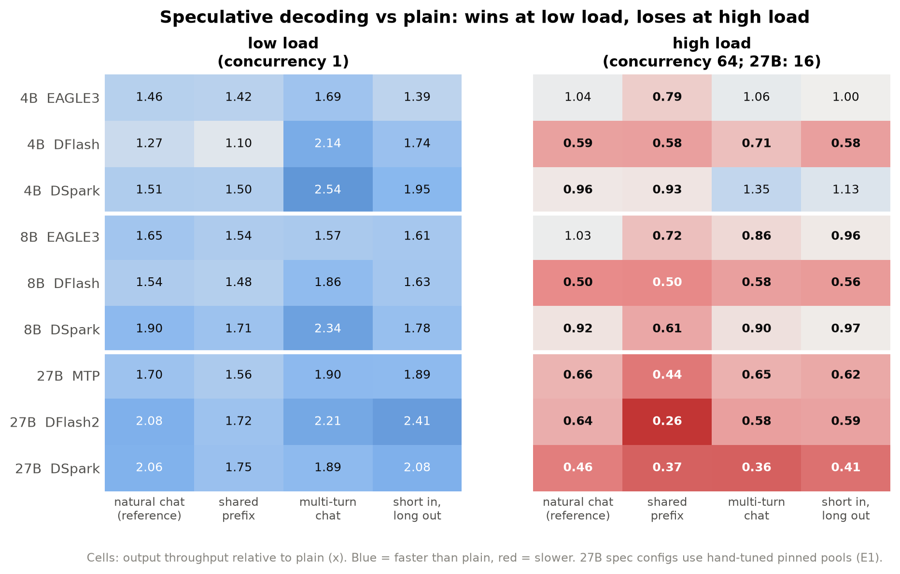
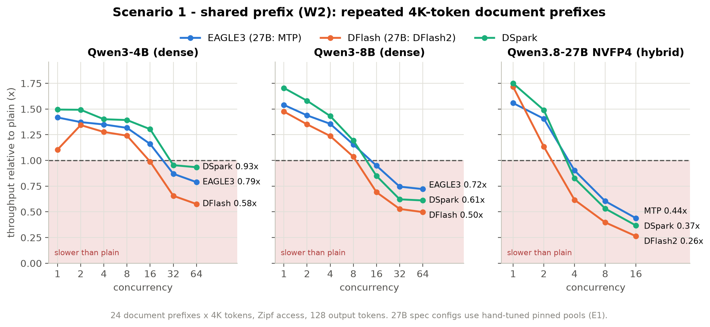
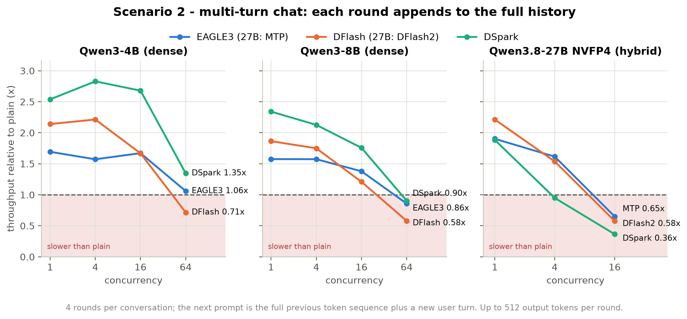
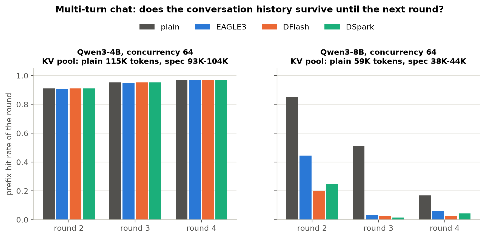
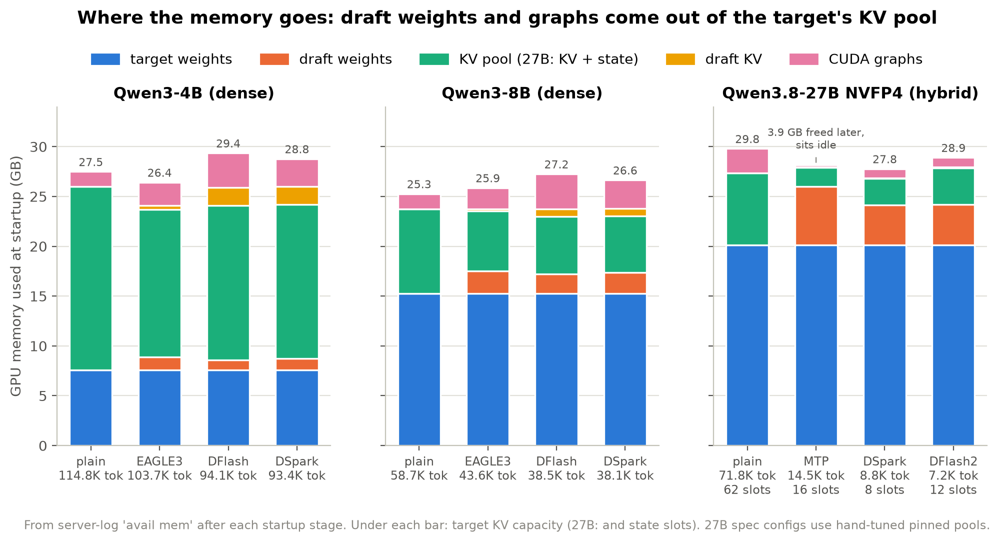
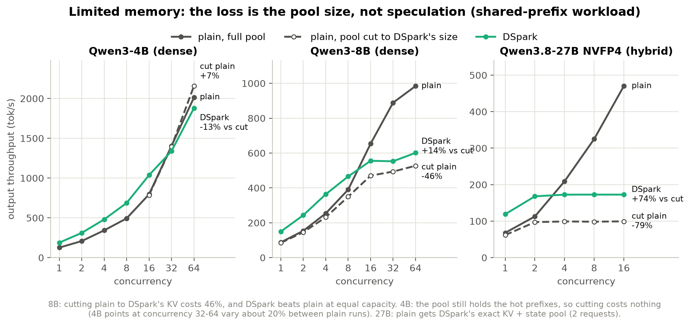
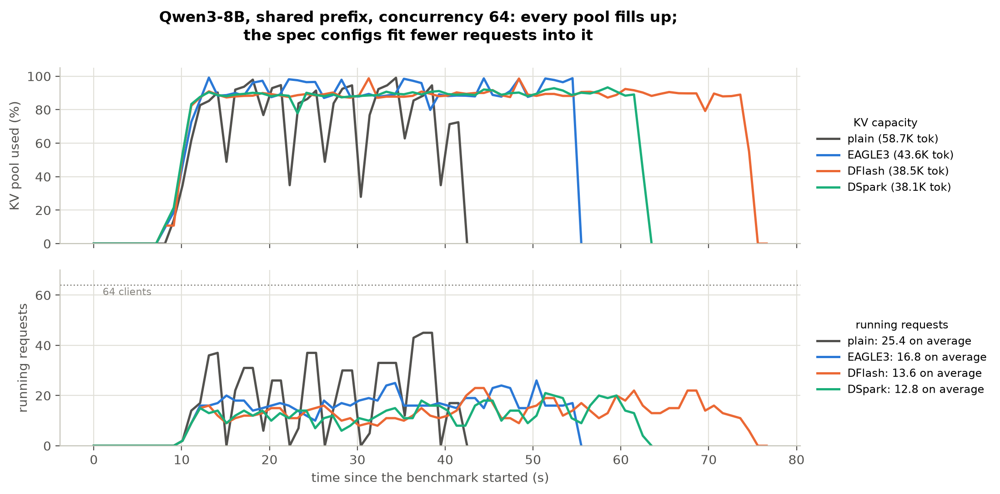
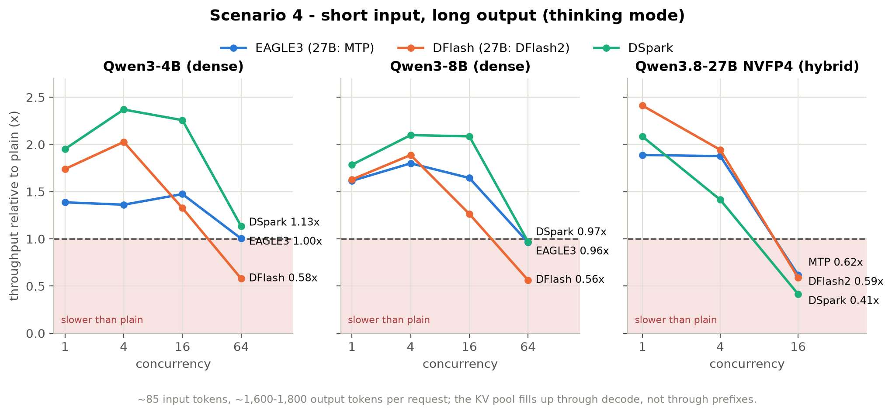

# 压力测试：四个场景的图

配合 [`01-stress-test.md`](01-stress-test.md) 使用。四个场景是：长前缀反复请求、多轮对话、显存容量有限、短输入长输出；每个场景都画了测过的模型（Qwen3-4B、Qwen3-8B、Qwen3.8-27B NVFP4）。

- 环境：RTX 5090 32 GB，SGLang v0.5.22（`baa9befa38`），cookbook 配置。
- drafter：EAGLE3 3/1/4、DFlash b16、DSpark block7。27B 用 MTP、DFlash2、DSpark，推测配置用 E1 手调的固定池子。
- 图里的"相对 plain 的倍数" = 推测配置的输出吞吐 / 同负载同并发下 plain 的输出吞吐。
- 图由 [`make_figures.py`](make_figures.py) 从 `experiments/` 下的归档 CSV 生成，重画：`uv run --no-project --with matplotlib python report/make_figures.py`。

## 总览

- 左边低负载（并发 1）全是蓝色：推测在每个模型、每个场景都快 1.1–2.5 倍。
- 右边高负载大多变红。8B 最低到 0.50 倍，27B 最低到 0.26 倍。
- 4B 是例外：KV 池够大，EAGLE3 和 DSpark 在自然对话、多轮、长输出上是 0.96–1.35 倍，基本持平或更快；共享前缀上是 0.79–0.93 倍。DFlash 在 4B 上照样输，原因是宽度 16 的 verify 在计算上不划算。

## 场景一：长前缀反复请求（shared prefix）

- 负载 W2：24 组 4K token 的文档前缀，按 Zipf 访问，前缀工作集约 98K token，比所有配置的 KV 池都大。
- 推测配置全部跌到 plain 以下的拐点：8B 在并发 16，27B 在并发 4，4B 在并发 32（DFlash 在 16）。
- 这是四个场景里推测输得最多的：8B 并发 64 时 0.50–0.72 倍，27B 并发 16 时 0.26–0.44 倍。

## 场景二：多轮对话（append）

- 每段对话 4 轮，下一轮的 prompt 是上一轮完整的 token 序列加新的用户消息，整段历史都可以复用。
- 并发 16 及以下，推测快 1.2–2.8 倍（8B / 4B）。
- 并发 64 时，8B 的历史保不住（第二张图右边）：两轮之间历史被别的请求挤出 KV 池。推测配置的池子小 26–35%，第 3、4 轮命中率接近 0；plain 还有 0.51 / 0.17。
- 4B 的池子装得下所有历史，四种配置第 2–4 轮命中率都在 0.91–0.97（第二张图左边），所以 DSpark 在并发 64 仍快 1.35 倍。
- 27B 推测配置在并发 16 时第 2–4 轮命中率都是 0，只有 plain 的 0.36–0.65 倍。

## 场景三：显存容量有限

### 显存都去哪了

- 4B 和 8B：KV 池之前的总量是固定的（由 static fraction 决定）。draft 权重和 draft KV 都从 target KV 里扣，8B 的 KV 少了 26–35%。
- CUDA graph 在池子分完之后才捕获。推测配置多出来的 0.6–2.0 GB graph 在 static 预算之外。
- 27B：推测配置的 state + KV 池只有 1.9–3.7 GB，plain 是 7.2 GB。MTP 有 3.9 GB 在池子分完后才释放，一直闲置（压力测试问题七：记账缺陷）。

### 损失来自池子大小，不是推测本身

- 做法：把 plain 的池子限制到和 DSpark 一样大，再比较。
- 8B 并发 64：plain 限到 DSpark 的 KV 后吞吐少 46%。同样大的池子里，DSpark 比 plain 快 14%。
- 27B 并发 16：plain 拿到和 DSpark 完全相同的 KV + state 池后，只剩 99 tok/s；同池 DSpark 是 173 tok/s，快 74%。
- 4B：池子限到推测配置的大小后，plain 没有变慢，因为 94K token 仍装得下热门前缀。4B 在并发 32–64 时，单次运行之间有约 20% 的波动。

### 服务时池子怎么被填满

- 8B 共享前缀负载，并发 64，逐秒采样。
- 四种配置（包括 plain）的 KV 池都用到 90% 以上。区别是同样满的池子能同时跑几个请求：平均下来 plain 25.4 个，推测配置只有 12.8–16.8 个。
- 所以推测配置虽然每个请求解码更快，跑完同样的请求反而要更长时间（横轴上结束得更晚）。

## 场景四：短输入长输出

- 负载：平均输入 85 token，用思考模式输出约 1,600–1,800 token。KV 是被 decode 撑满的，不是被前缀。
- 推测的收益在这个场景保持得最久：8B 并发 16 时 DSpark 仍快 2.09 倍。
- 8B 并发 64：EAGLE3 和 DSpark 每个请求的 decode 仍比 plain 快，TPOT 是 13–15 ms，plain 是 17 ms。但它们同时只能跑 28–32 个请求，plain 能跑 39 个，所以总吞吐只追平 plain（0.96–0.97 倍）。DFlash 再加上宽 verify，只有 0.56 倍。
- 因为不是前缀问题，HiCache 这类前缀卸载在这里帮不上，只能靠显存划分。

## 数据来源

| 图 | 文件（`experiments/` 下） |
|---|---|
| 总览、场景一、场景三的同容量对照 | `stress-qwen3-8b-v0.5.22/e2-v1/summary.csv`、`stress-qwen38-27b-v0.5.22/e2-v1/summary.csv`、`stress-gapfill-v0.5.22/gf-4b-e2.csv`、`phase1-followups-v0.5.22/q3q4-27b-serving.csv` |
| 场景二、场景四 | `stress-gapfill-v0.5.22/gf-multiturn.csv`、`gf-longgen.csv` |
| 显存构成、服务时间线 | `stress-gapfill-v0.5.22/memory-timeline-*.csv` |

全部是单次运行。8B 第一轮做过复现，并发 ≥ 8 的单格最多差 34%。
