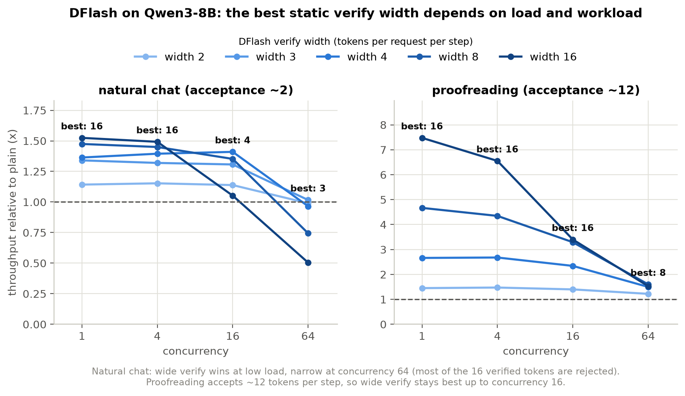
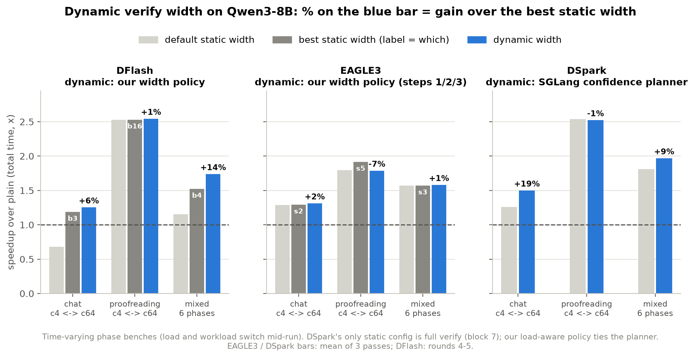
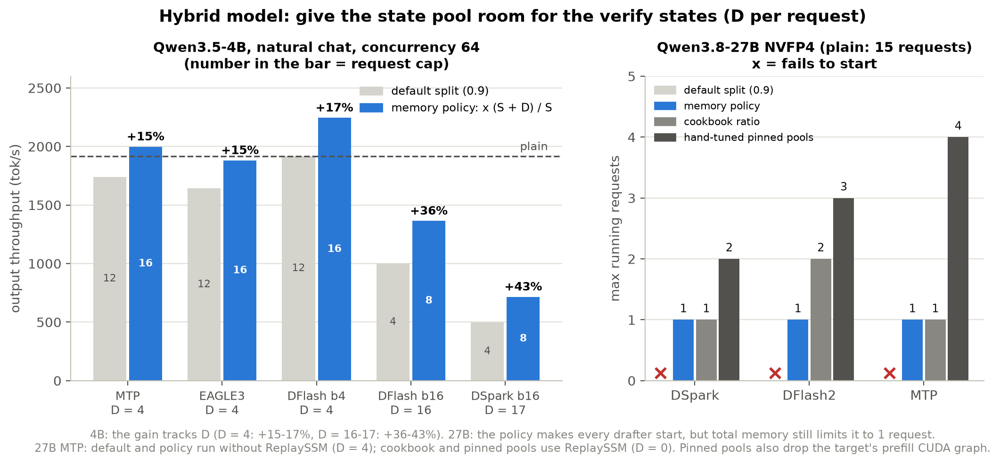
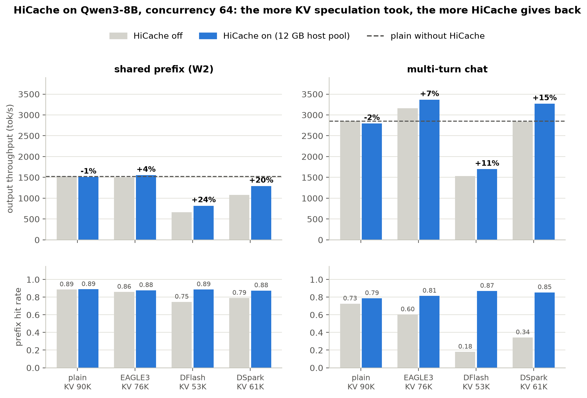

# 第二部分：三项优化

压力测试找到了推测解码在高负载下输给 plain 的两个原因：
- **计算浪费**：batch 大的时候，宽 verify 里大部分 token 被拒绝，算了白算。
- **显存挤占**：draft 的权重、KV、verify 状态和 graph 挤小了 target 的 KV / state 池，同时能跑的请求变少，前缀也保不住。

三项优化各对准其中一点，每一项都在 EAGLE3、DFlash、DSpark 三组 drafter 上测过：

| 优化 | 针对的问题 | 一句话做法 |
|---|---|---|
| 动态 verify 宽度 | 计算浪费 | verify 宽度随负载变：低负载宽，高负载窄 |
| hybrid 模型显存划分 | 显存挤占（hybrid 的 state 池） | 启动时按推测需要的 verify 状态数，给 state 池多分一些 |
| HiCache | 显存挤占（KV 池） | 被挤出 GPU 的前缀存到 CPU 内存，再用时取回，不重算 |

图由 [`make_figures.py`](make_figures.py) 生成。完整数字和实验设置在 `experiments/opt-align-v0.5.22/FINDINGS.md`。

---

## 1. 动态 verify 宽度（Dynamic verify width）

### 为什么要做

推测解码每一步都让 target 对每个请求检查一串 draft token，这串的长度就是 verify 宽度。一步的计算量约等于 batch × 宽度。

- **低负载**：batch 小，GPU 有空闲算力。宽一点几乎不增加时间，还能多接受几个 token，所以越宽越好。
- **高负载**：batch 大，GPU 已经算满。自然对话一步平均只接受约 2 个 token，宽度 16 时大部分 token 被拒绝，算了白算，所以要窄。

最优宽度随负载变，也随负载类型变。校对类任务一步能接受约 12 个 token，宽 verify 到更高的并发都还划算：

所以不存在一个在所有时候都最好的固定宽度。

### 做了什么

policy 在运行时测量当前宽度的实际吞吐，往宽或窄试一档，哪个快就留哪个。另有一条下限：一步 verify 的 token 总数（宽度 × batch）至少 64。batch 很小时，这条规则直接选最宽的候选，因为这时 GPU 有空闲算力。三组 drafter 的接法不同：

- **DFlash**：SGLang 原本只能用固定宽度 16。我们加了运行时改 verify 宽度的接口，让 policy 在 16 / 8 / 6 / 4 / 3 / 2 / 1 之间选。
- **EAGLE3**：宽度 = steps + 1。SGLang 的 `--speculative-adaptive` 已经为每个候选 steps 建好一套运行状态和 CUDA graph，policy 只决定用哪一套。
- **DSpark**：SGLang 自带置信度 planner，按每个请求的置信度决定 verify 多少 token，本身就是动态宽度。我们的 load-aware policy 只在 planner 和满 verify 之间切换。

### 结果

负载是"时变"的：同一次运行里，负载在低并发和高并发之间切换，或在对话和校对之间切换。比较的是跑完的总时间，换算成相对 plain 的加速比。

- **DFlash 收益最大**：比最好的固定宽度快 6–14%（对话、混合）。校对上最好的固定宽度本来就是 16，policy 一直停在 16，持平。
- **EAGLE3 收益很小**：对话和混合上只快 1–2%，校对上慢 7%。
  - EAGLE3 的宽度只能在 2–6 之间选，默认值离每段负载的最优都不远，能赚的空间本来就 ≤ 4%。
  - 每多一个候选宽度就多一套 CUDA graph：候选 {2, 3, 4} 让 KV 池少了 31%。想把校对上最好的宽度 6 也加进来，KV 池会少 64%，反而更慢。
  - SGLang 自带的 adaptive 默认建 4 套 graph，KV 池只剩 2.3K token，在 32 GB 卡上不可用。
- **DSpark 不需要我们的 policy**：SGLang 的 planner 比满 verify 快 9–19%（对话、混合），开环延迟也最好。我们的 load-aware policy 和 planner 持平。

---

## 2. Hybrid 模型的显存划分（Hybrid model）

### 为什么要做

hybrid 模型（例如 Qwen3.5 / Qwen3.8：GDN 层 + attention 层）有两个池子：

- **state 池**：每个请求的递归状态，一个请求占固定几个槽。它决定**能同时跑几个请求**。
- **KV 池**：attention 层的 KV。它决定能放多长的上下文。

SGLang 在启动时按一个固定比例（默认 0.9）划分两个池子，没有考虑推测解码。推测解码 verify 时，每个请求要额外占 D 个中间状态（D 约等于 verify 的 token 数）。于是开了推测之后，state 池先满，并发被卡住，KV 池却还有富余。例：Qwen3.5-4B 上 DFlash b16 最多只能同时跑 4 个请求。

### 做了什么

`--speculative-policy memory` 在启动时把 state 池的比例乘以 (S + D) / S：

- S：每个请求本来就要的 state 槽数（4B 的配置下是 5）。
- D：每个请求的 verify 中间状态数（EAGLE3 / MTP / DFlash b4 是 4，DFlash b16 是 16，DSpark b16 是 17）。
- 例：DSpark 的 D = 17，比例从 0.9 变成 0.9 × 22 / 5 ≈ 4.0。

这是启动时按推测配置算一次，不是运行时动态调整。

### 结果

- **4B（并发 64）**：五个 drafter 都提升，提升幅度由 D 决定，和 drafter 种类无关。
  - D = 4 的三个（MTP、EAGLE3、DFlash b4）是 +15–17%，请求上限从 12 变成 16。
  - D = 16–17 的两个（DFlash b16、DSpark）是 +36–43%，请求上限从 4 变成 8。
- **27B NVFP4**：默认比例下三个推测配置都起不来，state 池放不下一个请求。policy 让它们都能启动，但只能同时跑 1 个请求。cookbook 的比例和手调的固定池子能到 2–4 个。27B 的瓶颈是总显存，不是划分比例。

---

## 3. HiCache（分级 KV 缓存）

### 为什么要做

推测占掉的显存让 KV 池变小：在这组设置下，8B 的 KV 池 EAGLE3 少 16%、DSpark 少 32%、DFlash 少 41%。池子小了，共享前缀和对话历史更容易被挤出 GPU，下次用到时只能重新算一遍（prefill）。

### 做了什么

用 SGLang 现成的 HiCache，不改它的代码：GPU 上的 KV 被驱逐时写一份到 CPU 内存（这里给了 12 GB），下次命中时从 CPU 取回。压力测试测过，取回比重算便宜 3–20 倍。我们测的是：把它打开之后，每种 drafter 能收回多少损失。

### 结果

- **收益和推测挤掉的 KV 成正比**：KV 少 16% 的 EAGLE3 提升 4–7%，少 32–41% 的 DSpark / DFlash 提升 11–24%。plain 的池子本来就够，没有收益（−1% 到 −2%）。
- **命中率都补回来了**：开 HiCache 后，四种配置的前缀命中率都回到 0.79–0.89，和 plain 接近（下排）。
- **多轮对话上，开了 HiCache 的 EAGLE3 和 DSpark 超过了 plain**：分别是不开 HiCache 的 plain 的 1.18 倍和 1.15 倍。
- **补不回的是计算和并发**：DFlash 开了 HiCache 也只有 plain 的 0.54–0.60 倍，原因是宽度 16 的 verify，以及能同时跑的请求更少。
- 只对前缀和历史有用。短输入长输出的场景里，KV 是被 decode 撑满的，HiCache 帮不上。

---

## 三项放在一起

| 优化 | EAGLE3 | DFlash | DSpark |
|---|---|---|---|
| 动态 verify 宽度（8B） | +1–2%，校对 −7% | **+6–14%** | +9–19%（SGLang 自带 planner） |
| hybrid 显存划分（4B，并发 64） | +15% | b4 +17%，b16 **+36%** | **+43%** |
| HiCache（8B，并发 64，W2 / 多轮） | +4% / +7% | **+24%** / +11% | +20% / +15% |

- 每项优化的收益，取决于推测在这一项上占掉了多少：可调的宽度范围、每个请求的 verify 状态数、被挤掉的 KV。
- EAGLE3 本来就最轻（1 层 draft，宽度 2–6），三项上的收益都最小；DFlash / DSpark 最重，收益也最大。

## 口径

- 动态宽度的百分比是**加速比**之差（图里的口径）。按总时间算，DFlash 是少 5–12%。
- 动态宽度的 EAGLE3 / DSpark 结果是三遍平均，三遍相差 ≤ 1.5%。DFlash 来自第四、五轮，第五轮复现相差 0.5% 以内。显存划分和 HiCache 是单次运行。
- HiCache 的主机池 12 GB（81K token），比 plain 的设备池（90K）还小，对 plain 略不公平。
- 4B 显存划分用的 EAGLE3 / DSpark 是社区权重。DSpark 的接受长度只有 2.15，所以那一行比的是显存划分，不代表 drafter 本身好坏。
